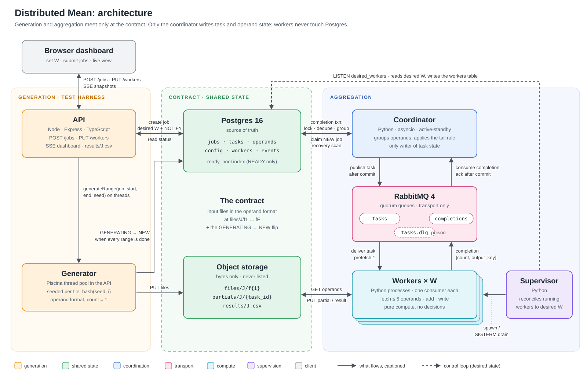
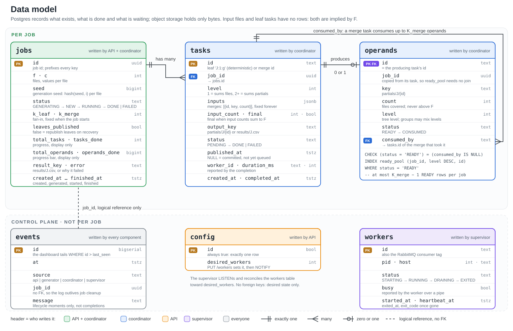

# Distributed Mean — Design

Oct 16 – 21, 2026 · @Rahul Chembakasseril

## Overview

Compute the index-wise mean across F files of C random values each, on W workers that run at different speeds and can each hold at most 5 files at a time. Many jobs may run at once.

| Quantity | Range |
| --- | --- |
| F, files per job | 1 < F < 100,000 |
| C, values per file | 1 < C < 1,000,000 (up to 8 MB as float64) |
| Worker limit | 5 operands at a time |

**Core idea: everything is an operand.** An operand is a sum vector plus a count; an input file is an operand with count 1. Every task is "add up to K operands into one" (K_leaf = K_merge = 5 by default), so summing files and merging partials are the same operation. The final task is simply the one whose input counts add up to F: there is no separate reducer.

Principles: each component has **one responsibility**; the coordinator is the **only writer** of task and operand state; **repeats are harmless** (messages and object writes may repeat, database transitions cannot); and **everything is scoped by `job_id`**, so jobs share the fleet but never share state.

## Architecture

| Component | Responsibility |
| --- | --- |
| API (Node, Express, TS) | creates jobs, sets desired W, serves status, results and the SSE dashboard |
| Generator (thread pool in the API) | writes seeded input files, flips the job to `NEW` |
| Coordinator (Python, active-standby) | starts jobs, publishes tasks, processes completions, groups operands, finishes jobs |
| Workers (Python, W processes) | fetch operands, add, write the output, report completion |
| Supervisor (Python) | spawns and drains workers to match desired W |
| Postgres | source of truth for jobs, tasks, partials, config, events |
| RabbitMQ | `tasks` (prefetch 1), `completions`, `tasks.dlq` |
| Object storage | bytes: `files/J/f{i}`, `partials/J/{task}`, `results/J.csv` |

## Data model

The full schema is on the next page. Three per-job tables carry the algorithm: `jobs` (one row per job), `tasks` (merge tasks from creation, leaf tasks only once they complete) and `operands` (partials only, each produced by one task and consumed by at most one merge). The control-plane tables hold the desired worker count, the supervisor's view of its workers and the event log.

Inputs and partials share one binary format (a 24-byte header with the count, then C float64 values); only the result is CSV. A partial stores a sum, never a mean, so merging is plain addition and counts carry the weighting.

## Job lifecycle

`GENERATING → NEW → RUNNING → DONE`, each transition owned by one component.

1. **Create (API).** `POST /jobs {F, C}` inserts a `GENERATING` job with a random seed and returns 202.
2. **Generate (API).** Worker threads write `files/J/f{i}` seeded by `hash(seed, i)`, then `UPDATE … SET status = 'NEW' WHERE status = 'GENERATING'`.
3. **Start (coordinator).** Sets the job `RUNNING`, publishes all ⌈F / K_leaf⌉ leaf tasks with publisher confirms, then sets `leaves_published`.
4. **Execute (workers).** Fetch inputs, add, write the output, publish a completion, ack.
5. **Complete (coordinator).** Dedupe, insert the output as a `READY` operand, group ready operands into the next task.
6. **Finish (coordinator).** The final task's completion sets the job `DONE`.

**Generation is a test harness behind a contract.** The two sides share only the file layout and the `GENERATING → NEW` flip, so real uploads could replace generation without touching aggregation. Generation sits behind `generateRange(job, start, end, seed)`; if it dominates job time, that function moves behind a queue for a generator fleet. Seeds are deterministic, so a restart regenerates identical bytes: `GENERATING` jobs are regenerated on API startup, and a graceful shutdown leaves them `GENERATING` rather than failing them.

## Grouping and completion

The coordinator groups ready partials inside each completion's transaction, so the merge tree builds itself as results arrive and merging overlaps leaf work. At F = 100,000 that is 20,000 leaves and about 5,000 merges.

Each completion is handled in one transaction:

1. **Lock the job.** Completions for the same job are processed one at a time.
2. **Dedupe.** Record the task as done only if this is its first completion: a leaf inserts its row, a merge moves from `PENDING` to `DONE`. If nothing changed, it is a duplicate: commit, ack and stop.
3. **Check and count.** The reported count must match what the task covers; add the task to the job's progress.
4. **Finish or pool.** If the task was final, mark the job `DONE`. Otherwise its output becomes a `READY` operand.
5. **Group.** If K_merge operands are `READY`, they become a new merge task. If fewer remain but their counts add up to F, they become the final task (the tail rule). A new task marks its inputs `CONSUMED`.
6. **Commit, publish, ack.** The new task is published only after the commit, and the completion is acked only after that.

- **Duplicates are no-ops.** A merge completes only from `PENDING`, and a leaf only by inserting its deterministic ID, so a second delivery of the same task or completion matches zero rows and is acked and ignored.
- **The tail rule needs no counter.** Every file's count is always in exactly one place: a `READY` operand or an unfinished task's inputs. So `READY` counts summing to F proves nothing is in flight.
- **The finish condition is exact.** Leaves cover disjoint files and each operand is consumed once under the row lock, so by induction an operand with count F covers every file exactly once. Reported counts are checked against the expected ones, and `DONE` is conditional, so it fires once.
- **Constant work per completion.** The pool never holds more than K_merge − 1 operands between completions, and grouping reads at most K_merge indexed rows. Mixing levels in one group is fine because counts carry the weighting, and it means fast workers never wait on slow siblings.

**Example (F = 12, file i = [i, 10i]).** Leaves of 5, 5 and 2 files produce partials with counts 5, 5, 2. When the third arrives the counts sum to 12 = F, so all three form the final task: [15, 150] + [40, 400] + [23, 230] = [78, 780], mean [6.5, 65].

## Worker execution

Workers are pure compute. The task message carries everything, including the output key: `{job_id, task_id, level, final, f, c, inputs: [{id, key, count}], output_key}`.

1. Fetch the inputs concurrently (at most 5 buffers).
2. Add them in place in a fixed pairing, (1+2), (3+4), then +5, so retries write identical bytes.
3. Write the sum to `partials/J/{task}`, or, if `final`, divide by F and write `results/J.csv`.
4. Publish the completion `{task_id, output_key, count, duration_ms, worker_id}`, wait for the confirm, then ack the task.

Fetching dominates: reading 8 MB takes tens of milliseconds, an add about 1 ms, so concurrent fetching gives close to a 5× speedup per task. All accumulation is float64.

**Configurable fan-in.** Memory is bounded by the fetch window, not the task size, so a worker can stream any number of operands (one accumulator plus 4 in-flight fetches). Both K values default to 5, the strict reading of "5 files at a time"; if the limit is only about memory, raising them is a configuration change.

| At F = 100,000, C = 1M | K = 5 | K_leaf = 1,000, K_merge = 10 |
| --- | --- | --- |
| Leaf / merge tasks | 20,000 / 5,000 | 100 / 11 |
| Partial writes | ~200 GB (~50% over the 800 GB input floor) | < 1 GB (~0.2%) |
| Work redone after a crash | up to 5 files | up to 1,000 files |

Keep K_merge small (5 to 10): merge inputs arrive over time, so a large K_merge turns the end of a job into one serial merge.

## Idempotency

Every file enters the final sum exactly once. Messages and object writes may repeat; these transitions cannot.

| Transition | Guard |
| --- | --- |
| Leaf completes | `INSERT … ON CONFLICT (id) DO NOTHING` on deterministic `J:1:g` |
| Merge completes | `UPDATE … WHERE status = 'PENDING'` |
| Operand becomes READY | inserted only after the dedupe; primary key = producing task |
| Operand is consumed | only `READY` rows are grouped, under the job-row lock; nothing moves back |
| Job leaves GENERATING / NEW, becomes DONE | conditional `WHERE status = …` |

**Why the row lock.** Every coordinator transaction starts with `SELECT … FOR UPDATE` on the job. A racing transaction blocks, then (at READ COMMITTED) sees the committed row and pool, so it cannot repeat a transition. **Invariant:** `READY` counts plus unfinished tasks' input counts always equal F.

## Failure detection and recovery

Every task row is committed before it is published, so a queued message always names a real task, and any gap is visible in Postgres (`published_at IS NULL`) and closed by republishing.

| Failure | Detected by | Recovery |
| --- | --- | --- |
| Worker crashes or disconnects | RabbitMQ, connection closes | immediate redelivery |
| Worker hangs while connected | RabbitMQ `consumer_timeout` (`RABBITMQ_CONSUMER_TIMEOUT_MS`, 10 min) | channel closed, redelivery |
| Coordinator dies between commit and publish | scan: `PENDING`, `published_at IS NULL`, older than 5 s | republish |
| Coordinator dies while publishing leaves | scan: `RUNNING AND NOT leaves_published` | republish all leaves |
| Coordinator dies mid-transaction or before ack | rollback, or task already `DONE` | completion redelivered; duplicate skipped |
| Poison task (corrupt input) | quorum-queue delivery limit; corrupt bytes rejected at once | `tasks.dlq`; task and job `FAILED` |
| API dies mid-generation | API startup: `status = 'GENERATING'` | regenerate identical bytes |
| Postgres unavailable | commits fail | completions wait unacked |

## Concurrency and scheduling

- **Concurrency comes from isolation.** Every key, query, check and task ID is scoped by `job_id`; any worker can run any job's task.
- **Pull queue, prefetch 1.** Faster workers take more tasks, with no speed estimates, and nothing is stranded behind a slow worker.
- **FIFO across jobs.** Ordering affects latency, never correctness. A 10-file job behind a maximum job waits roughly 2 minutes at W = 32. The fix, if needed, is capping each job's outstanding tasks and topping up round-robin.
- **No backpressure.** A task message is about 500 bytes, so even ten maximum jobs queue about 100 MB; leaves are published with asynchronous confirms.
- **Slow tail (optional, not built).** Once the queue is empty, a task out longer than 2 to 3 × p95 gets a duplicate; the first completion wins. At K = 5 the tail is one short task, so this only pays off with a large K_leaf.

## Configurable worker count (W)

The API records the desired W; a supervisor makes it true. `PUT /workers {count}` writes `config.desired_workers` and sends `NOTIFY` in one transaction, and the supervisor reconciles every 1 to 2 s or on the notification:

1. Count workers that are STARTING or RUNNING (draining ones do not count).
2. Too few: spawn the difference, with backoff for workers that die right after starting.
3. Too many: drain the difference, idle workers first, otherwise the youngest.

**Draining** sends SIGTERM: the worker cancels its consumer, finishes its task and exits. After `DRAIN_GRACE_S` (2 minutes, matching Compose's stop grace) it is killed and RabbitMQ redelivers its task, so nothing is lost. Workers set `PR_SET_PDEATHSIG`, so they drain if the supervisor dies. Changing W never affects correctness: W = 0 simply pauses processing.

## Observability

One background poller in the API reads Postgres and the RabbitMQ management API and pushes whole snapshots over SSE, so a hundred viewers cost the same as one.

- **Panels:** jobs with progress and ETA, workers (desired, running, busy), queue depth and ack rate, dead-lettered tasks, and a live event log of lifecycle moments (job created, started, done; worker started, drained). Individual task completions are counters, not events.
- **Exact progress.** Task counts are deterministic: L = ⌈F / K_leaf⌉ leaves, M = ⌈(L − 1) / (K_merge − 1)⌉ merges, and F + L + M − 1 operand reads. The bar is `operands_done / total_operands`, updated in the completion transaction; worker speed changes which operands are grouped, never how many groups there are.

## Scale-out path

Every transaction touches exactly one job, so the stateful parts (coordinator, queues, database) shard by `job_id`, each shard owning its jobs end to end. Everything else scales by adding instances: workers, generators and API servers. Storage bandwidth binds first: the coordinator does a little bookkeeping per task, while workers move megabytes.

## Design decisions

The design evolved by removing machinery: a static split became a pull queue, Redis sums became durable object keys, the reducer became continuous merging, and counters gave way to count conservation. Throughout, correctness comes from transitions that happen once, never from timing, and the design with fewer moving parts wins.

| Decision | Chosen | Over | Because |
| --- | --- | --- | --- |
| Work distribution | pull queue, prefetch 1 | static split by speed; prefetch 2 | adapts to drifting speeds and failures; pre-claiming strands work at the tail |
| Where sums accumulate | partials in object storage | Redis atomic adds | O(C) adds block single-threaded Redis, and Redis can lose progress |
| Duplicate protection | deterministic keys + conditional transitions | leases | a paused lease holder can still commit after expiry |
| Final reduce | continuous merging, unified operands | a reducer after all partials | no idle partials, no reducer state, one code path |
| Who coordinates | one coordinator | workers running claim transactions | one writer keeps workers pure and reasoning serial |
| Reliable publish | `published_at` + startup scan | outbox table with relay and sweeper | the coordinator already owns publishing |
| Leaf tasks | virtual, deterministic IDs | inserting ⌈F / K_leaf⌉ rows at start | constant-size job start, no write burst |
| In-flight tracking | count conservation | an in-flight counter | `READY` counts summing to F proves it with nothing to maintain |
| Queue technology | RabbitMQ | Postgres `SKIP LOCKED` queue | keeps workers off the database, push delivery, fast dead-worker detection |
| Worker count | supervisor reconciling desired state | API spawning processes; orchestrator replicas | survives restarts, keeps the API platform-agnostic |
| Dashboard | one in-process poller over SSE | per-connection polling; Grafana | constant cost per viewer; staleness of seconds is fine |
| Coordinator HA | active-standby, advisory lock | single process | failover in seconds; the row lock keeps overlap correct |
