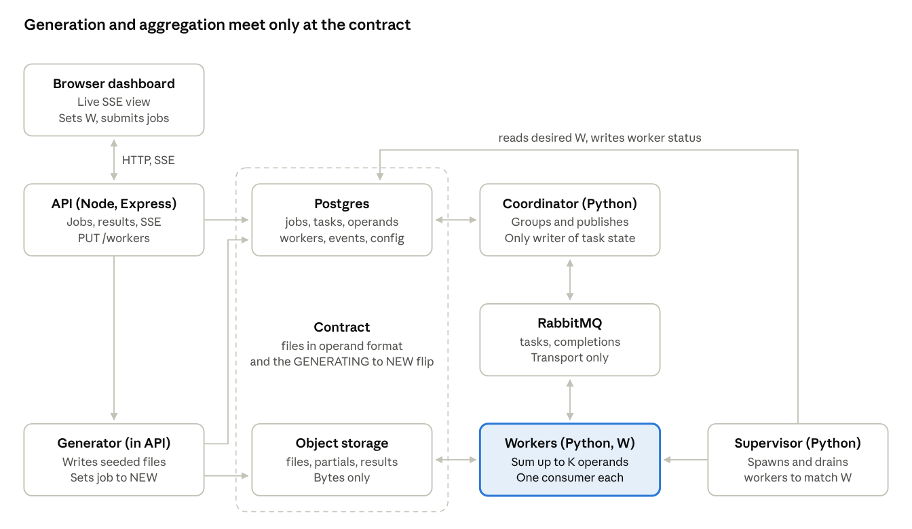

# Distributed Mean — Design

<p class="byline"><span>Oct 16, 2026</span> · <span>@Rahul Chembakasseril</span> · <span>revised Oct 18, 2026</span></p>

## Overview

The system computes the mean of every index across F files of C random values each, using a fleet of W workers that run at different speeds and can each handle at most 5 files at a time. Multiple jobs can be submitted and run concurrently.

| Quantity | Range |
| --- | --- |
| F, files per job | 1 < F < 100,000 |
| C, values per file | 1 < C < 1,000,000 |
| One vector in float64 | up to 8 MB |
| Worker limit | 5 files (operands) at a time |

**Core idea: everything is an operand.** Summing input files and summing partial results are the same operation. An operand is a sum vector plus a count; an input file is an operand with count 1. Every task is "add up to K operands into one operand" (K_leaf = K_merge = 5 by default, both tunable), and the final task is simply the one whose input counts add up to F. There is no separate reducer.

Design principles:

- **Single responsibility:** generation, coordination, computation, state and transport each live in one component.
- **One writer of state:** only the coordinator changes task and operand state; workers never touch the database.
- **Repeats are harmless:** messages and object writes may happen more than once; database state transitions cannot.
- **Scope everything by job:** every key, query and check carries `job_id`, so jobs share the fleet but never share state.

## Architecture

Each component has one responsibility, and only the coordinator changes task or operand state.



Read it left to right: the API creates the job and its generator writes the input files, the dashed contract column is the only thing generation and aggregation share, and on the right the coordinator, RabbitMQ and workers sum operands until one covers all F files. The supervisor keeps the number of worker processes at the desired W, and the browser dashboard talks only to the API.

| Component | Responsibility | Never does |
| --- | --- | --- |
| API (Node, Express, TypeScript) | creates jobs, runs the generator, serves status, results and the SSE dashboard | creates tasks or publishes to the task queue |
| Generator (option 1: thread pool inside the API) | writes seeded input files, flips the job to `NEW` | touches tasks or operands |
| Coordinator (Python) | starts jobs, publishes tasks, processes completions, groups operands, finishes jobs | reads or writes operand bytes |
| Workers (Python, W processes) | read operands, add, write the output, report completion | connect to Postgres or make decisions |
| Supervisor (Python) | spawns and drains worker processes until their count matches `desired_workers` | touches tasks, operands or the queues' messages |
| Postgres | source of truth for jobs, tasks and partial operands | — |
| RabbitMQ | `tasks` queue (coordinator to workers, prefetch 1) and `completions` queue (workers to coordinator) | decide grouping or completion |
| Object storage | operand bytes and results: `files/J/…`, `partials/J/…`, `results/J.csv` | decide membership; nothing ever lists it |

## Data model

Postgres records what exists, what is done and what is waiting to be summed; object storage holds only bytes. Input files never get their own rows: they are known from F and grouped into leaf tasks the moment a job starts, so they never wait in the ready pool.

```sql
jobs (
  id               uuid PRIMARY KEY,
  f                int NOT NULL,          -- files
  c                int NOT NULL,          -- values per file
  seed             bigint NOT NULL,       -- generation seed
  status           text NOT NULL,         -- GENERATING | NEW | RUNNING | DONE | FAILED
  leaves_published bool NOT NULL DEFAULT false,
  total_tasks      int,                   -- L + M, set at start (display only)
  tasks_done       int NOT NULL DEFAULT 0,
  total_operands   bigint,                -- F + L + M - 1 (display only)
  operands_done    bigint NOT NULL DEFAULT 0,
  result_key       text,
  gen_started_at, gen_finished_at, finished_at timestamptz
)

tasks (                                   -- merge tasks at creation; leaf tasks only once done
  id           text PRIMARY KEY,          -- leaves: 'J:1:g' (deterministic); merges: generated
  job_id       uuid NOT NULL REFERENCES jobs,
  level        int NOT NULL,              -- 1 = sums files, 2+ = sums partials
  inputs       jsonb,                     -- merges only: [{id, key, count}], fixed forever
  input_count  int,                       -- sum of input counts
  final        bool NOT NULL DEFAULT false,
  status       text NOT NULL,             -- PENDING | DONE | FAILED
  published_at timestamptz,               -- NULL = committed but not yet on the queue
  created_at, completed_at timestamptz
)

operands (                                -- partials only
  id          text PRIMARY KEY REFERENCES tasks,   -- = producing task id
  job_id      uuid NOT NULL,
  key         text NOT NULL,              -- partials/J/{id}
  count       int NOT NULL,
  level       int NOT NULL,
  status      text NOT NULL,              -- READY | CONSUMED
  consumed_by text REFERENCES tasks
)

CREATE INDEX ready_pool ON operands (job_id, level DESC, id) WHERE status = 'READY';
```

| Thing | Bytes | Identity and grouping |
| --- | --- | --- |
| Input file | `files/J/f{i}` | implicit from `jobs.f`; leaf g covers files 5g+1 to 5g+5 |
| Partial | `partials/J/{task_id}` | `operands` row, READY or CONSUMED |
| Result | `results/J.csv` | `jobs.result_key` |

Input files and partials share one binary format: a count header followed by C float64 values. Only the final result is written as CSV. A partial stores a sum, never a mean, so adding partials is plain addition and the counts carry the weighting.

## Job lifecycle

A job moves through `GENERATING → NEW → RUNNING → DONE`, with each transition owned by exactly one component.

1. **Create (API).** `POST /jobs {F, C}` inserts the job as `GENERATING` with a random seed and returns 202 with the job ID.
2. **Generate (API, option 1).** The API splits files 1 to F into ranges for a pool of Node worker threads. Each thread generates its files with an RNG seeded from `hash(seed, file_index)`, encodes them in the operand format with count 1, and uploads them to `files/J/f{i}` with bounded upload concurrency. When every range is done: `UPDATE jobs SET status = 'NEW', gen_finished_at = now() WHERE id = $J AND status = 'GENERATING'`.
3. **Start (coordinator).** It sees the `NEW` job, sets it `RUNNING`, publishes all ⌈F/5⌉ leaf tasks with asynchronous publisher confirms (task IDs `J:1:g`, inputs computed from g), then sets `leaves_published = true`.
4. **Execute (workers).** A worker takes a task, fetches its operands, adds them, writes the output (a partial, or the divided result if the task is `final`), publishes a completion and acks.
5. **Complete (coordinator).** It dedupes the completion, inserts the output as a `READY` operand, and groups ready operands into the next task (see Grouping and completion).
6. **Finish (coordinator).** The final task's completion sets the job `DONE` with its result key.

**Generation and the boundary.** Generation is a test harness, not part of aggregation. The two sides meet only at a fixed contract: files at `files/J/f1 … fF` in the operand format, and the `GENERATING → NEW` transition. The generator never touches tasks or operands, and the coordinator never sees seeds or generation progress, so real uploads could replace generation without changing the pipeline.

Generation sits behind one function, `generateRange(jobId, start, end, seed)`. If `gen_started_at` to `gen_finished_at` shows generation dominating job time, option 2 moves that function behind a generate queue consumed by a separate generator fleet: one flat level of range tasks, fanned in by a count of done ranges, with no change to aggregation. Retries in either option regenerate identical bytes because the seeds are deterministic, and an API crash or restart mid-generation is recovered by regenerating every `GENERATING` job on startup; a graceful shutdown leaves interrupted jobs `GENERATING` rather than failing them.

## Grouping and completion

The coordinator groups ready partials inside each completion's transaction, so the merge tree builds itself as results arrive and merging overlaps with leaf work. At F = 100,000 the tree has about 20,000 leaves, then 4,000, 800, 160, 32, 7, 2 and 1 tasks, roughly 25,000 in all.

### The completion transaction

```sql
BEGIN;
SELECT f FROM jobs WHERE id = $J FOR UPDATE;   -- serialize this job's commits

-- 1. dedupe (leaf, or merge)
INSERT INTO tasks (id, job_id, level, status, completed_at)
VALUES ($T, $J, 1, 'DONE', now()) ON CONFLICT (id) DO NOTHING;
-- or: UPDATE tasks SET status = 'DONE', completed_at = now()
--     WHERE id = $T AND status = 'PENDING';
-- 0 rows changed → duplicate: COMMIT, ack, stop

-- 2. the output becomes a READY operand (unless this task was final)
INSERT INTO operands (id, job_id, key, count, level, status)
VALUES ($T, $J, $key, $count, $level, 'READY');

-- 3. group
SELECT id, key, count FROM operands
WHERE job_id = $J AND status = 'READY'
ORDER BY level DESC, id LIMIT 5;
-- if 5 rows                          → merge task of those 5
-- else if ≥ 2 rows and SUM(count) = F → final task of all of them
-- creating a task: INSERT INTO tasks (..., inputs, input_count, final, 'PENDING')
--                  UPDATE operands SET status = 'CONSUMED', consumed_by = $new
COMMIT;
-- then publish the new task and set its published_at; then ack the completion
```

If the completed task was final, step 2 is replaced by `UPDATE jobs SET status = 'DONE', result_key = $key, finished_at = now() WHERE id = $J AND status = 'RUNNING'`.

**Why a merge completes only from `PENDING`.** A merge task is `PENDING` from creation until its first completion. If RabbitMQ delivers the task twice, or a completion is published twice, only the first completion changes the row; every later one matches zero rows, so it is acked and ignored as a harmless no-op. A `FAILED` task can never be completed afterwards.

**Why the tail rule needs no counter.** Every file's count is always in exactly one place: a `READY` operand, or the inputs of an unfinished task. So `READY` counts summing to F means nothing is still in flight, and the last 2 to 4 partials can be grouped safely. A task is marked `final` when its input counts sum to F; for a job with F ≤ 5 the single leaf task is final.

**Why it is cheap.** Grouping runs on every completion and fires as soon as 5 operands are `READY`, so between completions a job's pool never holds more than 4 operands. Every grouping query touches at most 5 indexed rows: constant work per completion, about 25,000 small transactions per job at F = 100,000. Mixed levels in one group are fine because counts carry the weighting.

**Worked example (F = 12, file i holds [i, 10i]).** Leaves T1 = f1–f5, T2 = f6–f10, T3 = f11–f12 produce partials with counts 5, 5 and 2. When the third partial arrives the `READY` counts sum to 12 = F, so the coordinator groups all three into a final task, which adds [15, 150] + [40, 400] + [23, 230] = [78, 780] with count 12 and writes the mean [6.5, 65].

## Worker execution

Workers are pure compute with one code path. A worker never connects to Postgres and never decides anything; the task message tells it everything, including where to write.

Task message: `{job_id, task_id, level, final, f, c, inputs: [{id, key, count}], output_key}`

1. Fetch all inputs concurrently (at most 5 buffers).
2. Add them in place, in a fixed pairing: `b1 += b2` and `b3 += b4` in parallel, then `b1 += b3`, then `b1 += b5`; each buffer is freed as soon as it has been added. Counts add the same way.
3. If `final` is false, PUT the sum to `output_key` (`partials/J/{task_id}`). If it is true, divide by F and PUT the CSV to `output_key` (`results/J.csv`). Workers never build keys.
4. Publish `{job_id, task_id, output_key, count, duration_ms, worker_id}` to `completions` and wait for the broker's confirm.
5. Ack the task.

Notes

- **Fetching dominates.** Reading an operand of 1M values takes tens of milliseconds; an add takes about 1 ms. Concurrent fetching gives close to a 5× speedup per task; the parallel adds save about a millisecond.
- **Deterministic output.** The pairing is fixed by operand order, not arrival order, so a retry writes identical bytes. Pairwise addition is also slightly more accurate than a running sum.
- **Precision.** All accumulation is in float64.
- **Memory.** Never more than the 5 fetched buffers, decreasing as adds complete. numpy releases the GIL for large array operations, so the parallel adds really run in parallel.

### Configurable fan-in (K_leaf, K_merge)

Memory is bounded by the fetch window, not by the number of operands in a task, so a worker can stream any number of operands: one float64 accumulator plus a window of 4 in-flight fetches, adding in task order. Task size becomes two configuration values, both defaulting to 5 to match the assignment's wording.

| | K = 5 (default) | K_leaf = 1,000, K_merge = 10 |
| --- | --- | --- |
| Leaf tasks at F = 100,000 | 20,000 | 100 |
| Merge tasks | about 5,000 | about 11 |
| Coordinator transactions | about 25,000 | about 111 |
| Partial writes at C = 1M | about 200 GB | about 0.9 GB |

- **K_leaf is large when allowed:** every leaf is available at job start, so a larger value just means fewer tasks and far fewer partials. Keep leaf tasks at about 10 × W or more for load balance, and aim for tasks lasting seconds to tens of seconds.
- **K_merge stays small (5 to 10):** merge inputs arrive over time, so a large K_merge delays merging and turns the end of the job into one serial merge on one worker.

**Assumption:** the design assumes the stricter reading of "5 files at a time", 5 operands per task, so both K_leaf and K_merge default to 5. If the limit is only about memory, raising them is a configuration change.

## Idempotency

The guarantee is that every file's contribution enters the final sum exactly once. Messages and object writes may repeat; the database transitions below cannot, and they are what decide what is counted.

A task's inputs are fixed when it is created and its output key is deterministic, so a duplicate execution overwrites identical bytes and its completion is ignored. The worker's pre-check is unnecessary: duplicates only cost compute.

| | K = 5 (default) | K_leaf = 1,000, K_merge = 10 |
| --- | --- | --- |
| Work redone after a crash | up to 5 files | up to 1,000 files |

| Transition | Guard | Why it happens only once |
| --- | --- | --- |
| Leaf task completes | `INSERT … ON CONFLICT (id) DO NOTHING` on `J:1:g` | primary key on a deterministic ID |
| Merge task completes | `UPDATE … WHERE status = 'PENDING'` | the conditional update matches one row once; later completions are no-ops |
| Operand becomes READY | inserted only by the first completion; id = producing task ID | primary key, and it runs only after the dedupe above |
| Operand is consumed | grouping marks it `CONSUMED` under the job-row lock | only `READY` rows are selected; nothing moves back |
| Job leaves GENERATING / NEW | `WHERE status = 'GENERATING'` / `WHERE status = 'NEW'` | conditional update |
| Job becomes DONE | `WHERE status = 'RUNNING'` | conditional update |

**Why the row lock matters.** Each coordinator transaction starts with `SELECT … FROM jobs WHERE id = $J FOR UPDATE`. If two transactions race for the same job, the second blocks; when the first commits, Postgres (at READ COMMITTED) returns the latest committed version of the locked row, so the second sees the new status or the new pool and cannot repeat the transition. Without `FOR UPDATE` the second would read its stale snapshot and duplicate the work.

**Invariant.** `READY` partial counts plus the input counts of unfinished tasks always equal F, and no operand's count can exceed F. A count above F is a bug alarm.

## Failure detection and recovery

Postgres records the intent to publish; the broker's confirm records that it happened. Every task row is committed before it is published, so a message on the queue always corresponds to a real task with fixed inputs, and any gap between the two is visible in Postgres and closed by republishing.

| What went wrong | Who detects it | Precise condition | Recovery |
| --- | --- | --- | --- |
| Worker crashed or lost its connection | RabbitMQ | connection closes | immediate redelivery |
| Worker hung but stayed connected | RabbitMQ | unacked longer than `consumer_timeout` (`RABBITMQ_CONSUMER_TIMEOUT_MS`, default 10 min) | channel closed, redelivery |
| Coordinator crashed after creating a merge, before publishing it | coordinator scan | `status = 'PENDING' AND published_at IS NULL AND created_at < now() − 5 s` | publish, set `published_at` |
| Coordinator crashed while publishing a job's leaves | coordinator scan | `status = 'RUNNING' AND NOT leaves_published` | republish all leaves, set the flag |
| Coordinator crashed mid-transaction | — | transaction rolled back | completion unacked, redelivered |
| Coordinator crashed before acking a completion | — | task already DONE | duplicate completion acked and skipped |
| Poison task (corrupt input) | RabbitMQ | delivery limit (about 5) on a quorum queue; corrupt bytes are rejected at once | dead-letter queue; task and job marked FAILED |
| API crashed or restarted mid-generation | API on restart | `status = 'GENERATING'` | regenerate; seeds make it identical |
| Postgres unavailable | — | commits fail | completions stay unacked and wait |

- The 5-second grace keeps the periodic scan (every 10 s) from republishing tasks that are just in the normal milliseconds-long gap between commit and publish. At startup or leader takeover nothing is in progress, so the scan republishes immediately.
- A crash mid-publish of leaves republishes all of them, duplicating up to a job's leaf work. Such crashes should be rare, so a boolean flag is acceptable; a per-batch `leaves_published_upto` marker would cap the duplicates at one batch.
- Broker message loss after a publisher confirm is very unlikely with quorum queues, so no detector is built for it. If ever needed: once the tasks queue has had zero waiting messages for longer than 5 × the p95 task duration, any unfinished task is lost or on a very slow worker, and can be republished as a backup copy.

### Coordinator availability

Two coordinator processes run; the one holding `pg_try_advisory_lock` is the leader and the other retries every few seconds. If the leader dies, its Postgres session ends and releases the lock, and the standby takes over after running the startup scan. The leader does all writes on the session that holds the lock, so a zombie leader cannot write, and the job-row lock keeps any brief overlap correct. While no coordinator is running, no new tasks are created, but nothing is lost: workers finish what they hold and completions wait in the queue.

## Scale-out path

Each component scales out without redesign: generation fans out over a fleet, workers scale by adding consumers, and the stateful parts (coordinator, RabbitMQ, Postgres) shard by `job_id`. Sharding works because every transaction touches exactly one job: the job-row lock, the ready-pool query and the completion check are all scoped by `job_id`, and no transaction spans two jobs.

- **Fixed logical partitions.** Jobs map to `hash(job_id) mod P` with P = 64, so partitions can later move between machines without rehashing any job.
- **Cells.** Coordinator partitions, queue partitions and database shards are the same partitions. A cell is one coordinator, its queues and its database shard, and scaling the stateful side means adding cells.

| Component | How it scales | Notes |
| --- | --- | --- |
| Generation | fan-out over a generator fleet (option 2) | `generateRange` moves behind a generate queue; range tasks are fanned in by a count of done ranges, and aggregation is unchanged |
| Workers | add consumers | raise W through the supervisor; on several hosts, one supervisor per host with its share of W; bounded by storage bandwidth, not coordination |
| Coordinator | one leader per partition | each partition elects its own leader with its own advisory lock; one process can own several partitions, and a standby takes over any that go quiet |
| RabbitMQ | per-partition queues | `tasks.p{n}` and `completions.p{n}`, routed by a consistent-hash exchange on `job_id`, with quorum leaders spread across cluster nodes; workers stay job-agnostic by consuming from every task partition with a channel-wide prefetch of 1 |
| Postgres | shard by `job_id` | `jobs`, `tasks` and `operands` live together on one shard, so the completion transaction never crosses shards; done by application routing or with Citus, using `job_id` as the distribution column |
| Object storage | already partitioned | every key is prefixed by job; move from a local volume to S3 or a MinIO cluster |
| API | stateless instances behind a load balancer | the dashboard poller either runs per instance or publishes snapshots to a shared store |

- **Global state stays small and unsharded.** `config`, `workers` and `events` describe the system, not a job, so they live on a small control database.
- **Cross-shard reads are needed only by the dashboard,** whose poller queries each shard and merges the results; a few seconds of staleness is already acceptable there.

This is a path, not part of the build. A job is about 25,000 small transactions at F = 100,000 and one Postgres handles thousands per second, so operand storage I/O and generation become the bottlenecks well before the database, the broker or a single coordinator do.

## Concurrency and scheduling

- **Many jobs at once comes from isolation, not interleaving.** Every storage key, ready-pool query, completion check and task ID is scoped by `job_id`, so jobs share the worker fleet and the tasks queue but never share state. Any worker can run any job's task.
- **Pull queue, prefetch = 1.** Faster workers simply take more tasks, so no speed estimates or static partitioning are needed, and no work is ever stranded behind a slow worker.
- **FIFO across jobs.** Ordering only decides which job a free worker serves next; it affects latency, never correctness or capacity. A job submitted behind a large one finishes after that job's leaves drain.
- **Merge priority (optional).** One queue argument plus a priority on merge messages lets a nearly finished job's merges jump ahead of a newer job's leaves. For a single job it changes peak partial storage, not completion time, because workers stay busy either way.
- **No backpressure and no in-flight counter.** A task message is about 500 bytes, so even ten maximum-size jobs are about 100 MB of messages, well within RabbitMQ's capacity. All leaves are published at job start with asynchronous confirms (about 10,000 to 50,000 messages per second on one channel), and the tail rule uses count conservation instead of a counter. If many large concurrent jobs ever trigger RabbitMQ's memory alarms, add a top-up-by-queue-depth publisher then.
- **Publishing is not serialized.** With asynchronous confirms the coordinator streams messages and the broker confirms them in batches; workers start on the first messages immediately, and separate jobs can publish on separate channels concurrently.

### Slow tail: backup tasks (optional)

A job cannot finish until its last task does. If that task lands on the slowest worker, or on one that is hung but still connected, the rest of the fleet sits idle waiting. A backup-task speculator in the coordinator shortens that tail:

1. It acts only when the tasks queue has zero waiting messages and some workers are free. Before that, any unfinished task might simply be queued, so waiting time proves nothing.
2. The coordinator keeps a running p50 and p95 task duration from the durations workers report in their completions.
3. Any unfinished task that has been out longer than about 2 to 3 × p95, measured from when the queue emptied or when the task was published, whichever is later, gets a duplicate published.
4. A free worker runs the copy. Whichever completion arrives first counts; the other is deduplicated as usual and its compute is wasted, since workers never check the database and cannot stop early.

Duplicates are safe because a task's inputs and output key are fixed and completions are deduplicated. The cost is a little duplicate work, only at the tail and only for a few tasks.

Whether it pays off depends on task size. At the default K = 5 tasks are short, so the tail is at most one short task on the slowest worker, and a hung worker is still caught by RabbitMQ's consumer timeout; the speculator is not built by default. With a large K_leaf, one slow leaf can delay a job by minutes and the speculator becomes worthwhile. The dashboard shows when it is needed: operands per second drops sharply near a job's end while workers sit free.

## Configurable worker count (W)

The API records how many workers are wanted; a supervisor makes it true. This desired-state pattern keeps process ownership out of the Node API, survives restarts of either side, and changes nothing about how jobs run.

**One consumer per process.** Each worker process opens its own RabbitMQ connection and channel and registers as its own consumer on `tasks` with prefetch = 1, with its consumer tag set to its `workers.id`. RabbitMQ hands the next waiting task to whichever consumer has nothing unacked, so faster processes take more; a crash closes only that process's connection and redelivers only its one task. pika is not thread-safe and the GIL limits threads, so separate processes are also the natural fit for Python. The coordinator is a separate consumer on `completions`.

### Pieces

- `PUT /workers {count}` validates the count (0 to a host limit of about 2 to 4 × CPU cores), writes `desired_workers` to a one-row `config` table, logs an event and returns 202. The last write wins, which is the right semantics for a target.
- `GET /workers` returns desired, starting, running, draining, busy and free.
- The supervisor, one Python process, is the parent of every worker and the only component that starts or stops them. It keeps a `workers` table (`id, pid, status STARTING | RUNNING | DRAINING | EXITED, started_at, heartbeat_at`) that only it writes, so workers still never touch Postgres. Each worker reports ready, busy and idle to it over a pipe.

### Reconcile loop (every 1 to 2 s, or immediately on a Postgres NOTIFY from the API)

1. Read `desired_workers`.
2. Count workers that are STARTING or RUNNING; draining workers do not count.
3. Too few: spawn the difference. A new worker is STARTING until it reports ready. A worker that dies within seconds of starting is retried with increasing backoff, so an unreachable broker does not cause a crash loop.
4. Too many: drain the difference, idle workers first (they stop at once), otherwise the youngest.
5. Update the `workers` table and log an event for every change.

**Draining a worker.** The supervisor sends SIGTERM; the worker cancels its consumer so it receives nothing new, finishes its current task (publish completion, ack) and exits. After a grace period longer than any normal task (`DRAIN_GRACE_S`, default 2 minutes, which is also Compose's stop grace period for the supervisor) the supervisor sends SIGKILL, and RabbitMQ redelivers the unacked task, so even a forced kill loses no work. Raise the grace with `K_LEAF`: a task that outlives it is killed and redelivered.

### Failures

- **A worker crashes:** the supervisor sees the exit, marks it EXITED, and the next reconcile spawns a replacement.
- **The supervisor crashes:** each worker sets `PR_SET_PDEATHSIG` (Linux), so it receives SIGTERM when its parent dies and drains normally. The supervisor runs under systemd or a Docker restart policy; on restart it reads `desired_workers` and respawns.
- **Effect on jobs:** none. Changing W only changes how many consumers pull from the shared queue, so tasks rebalance automatically mid-job, and W = 0 pauses processing until workers return.

An alternative is to have the API change a Docker Compose or Kubernetes replica count. It is the same desired-state idea with less code, but it ties the API to the deployment platform; the assignment frames W as a count of Python processes, so the supervisor is the direct fit.

## Observability

The single API instance runs one background poller that reads Postgres and the RabbitMQ management API, keeps the latest snapshots in memory, and pushes changes to browsers over Server-Sent Events. Slightly stale data is acceptable.

| Stream | Source | Interval | Contents |
| --- | --- | --- | --- |
| `job:{id}` | `jobs` and `tasks`, only for jobs with open streams | 1 to 2 s | status, progress bar and ETA, tasks done out of total, generation time, result link when DONE |
| `queue` | RabbitMQ `/api/queues` | 5 s | waiting and unacked messages, consumers, ack rate, redeliveries |
| `workers` | RabbitMQ `/api/channels` | 5 s | per worker: busy (unacked > 0) or free, ack rate |
| `system` | `jobs` | 2 s | jobs by status: generating, queued, running, done, failed |

- Workers set their consumer tag to their worker ID, so channels map to workers.
- Snapshots are sent whole, so a reconnecting `EventSource` simply receives the next one.
- SSE needs `text/event-stream`, `Cache-Control: no-cache`, proxy buffering off, and a heartbeat comment every 15 to 30 s.
- If the API restarts, streams drop and reconnect; jobs are unaffected because workers never depend on the API.

### Exact progress

The grouping rule makes a job's task count deterministic, so progress can be exact rather than estimated. Every non-final merge has exactly K_merge inputs and removes K_merge − 1 operands, only the final task may be smaller, and the job must go from L partials to 1:

- Leaves: L = ⌈F / K_leaf⌉
- Merges: M = ⌈(L − 1) / (K_merge − 1)⌉, or 0 when L = 1
- Operands read in total: F + L + M − 1 (every input file once, every partial except the result once)

| L (K_merge = 5) | Merges | How |
| --- | --- | --- |
| 3 | 1 | one final of 3 |
| 5 | 1 | one final of 5 |
| 6 | 2 | a merge of 5, then a final of 2 |
| 20,000 | 5,000 | ⌈19,999 / 4⌉ |

Worker speed and arrival order change which operands are grouped together, never how many groups there are. When a job starts, the coordinator stores `total_tasks = L + M` and `total_operands = F + L + M − 1`; each first completion adds 1 to `tasks_done` and its input count to `operands_done`, inside the transaction that already holds the job-row lock. The progress bar is `operands_done / total_operands`, which stays accurate even when K_leaf and K_merge differ and a leaf does far more work than a merge, and the ETA is the remaining operands divided by the recent operands-per-second rate. These counters are for display only: nothing decides anything from them.

### System panel

| Metric | Source |
| --- | --- |
| Workers desired, starting, running, draining | `config`, `workers` |
| Workers busy vs free | RabbitMQ channels (unacked > 0 = busy), joined on consumer tag |
| Tasks waiting / in progress | RabbitMQ `tasks` ready and unacked counts |
| Throughput | RabbitMQ ack rate, and operands per second from `jobs` |
| Dead-lettered tasks | DLQ message count |
| Jobs by status | `jobs` grouped by status |

### Event log

An append-only `events` table (`id, at, source, job_id, message`) records lifecycle moments only, each written in the same transaction as the change it describes:

- API: job created, W changed
- Generator: generation started and finished
- Coordinator: job started, done or failed; task republished or dead-lettered
- Supervisor: worker started, draining, exited or force-killed

The poller tails it with `WHERE id > $last_seen` and pushes new rows over SSE. Individual task completions are not logged, since there can be about 25,000 per job; they appear as counters and throughput instead.

### UI

One page over a single `EventSource`: a W control (number input and Apply, calling `PUT /workers`), the system panel, a jobs table with progress bars and a new-job form for F and C, and the live event log.

## Design decisions and alternatives

The design was reached in stages. Each stage fixed a weakness exposed by the previous one, and several later stages removed machinery rather than adding it.

### How the design evolved

1. **Decompose the mean.** A mean is a decomposable aggregate: carry (sum, count) pairs, merge by addition, divide once at the end. Averaging averages is wrong unless weighted by count.
2. **Schedule for unequal speeds.** A static split proportional to measured speed was the first idea; it was corrected from minimizing a sum of times to minimizing the slowest finish time, then replaced by a pull queue that reaches the same split adaptively and survives failures.
3. **Make aggregation durable and idempotent.** In-memory aggregation in Redis gave way to deterministic object keys plus guarded database transitions, which make duplicates harmless by construction.
4. **Remove the reducer.** Waiting for all partials before reducing left finished work idle, so merging became continuous. Recognizing that summing files and summing partials are the same operation collapsed sub-jobs, merges and the reducer into one task type.
5. **Separate concerns.** Coordination moved out of workers into a single coordinator, generation moved behind a storage contract, and workers became pure adders.
6. **Simplify for scale.** Leaf tasks became virtual, counters and backpressure were removed in favour of count conservation, and fan-in became a tunable parameter.

### Decision log

| Decision | Options considered | Chosen | Deciding trade-off |
| --- | --- | --- | --- |
| Work distribution | static split proportional to worker speed; hybrid static split plus queue; pull queue | pull queue | adapts to drifting speeds and failures with no estimates; the static split needs stable, accurate speeds |
| Queue prefetch | prefetch 2 or pre-claiming the next task; prefetch 1 | prefetch 1 | pre-claiming saves one broker round trip but strands reserved work behind slow workers at the tail |
| Where sums accumulate | Redis with atomic Lua adds; Redis with dimension sharding or a C module; partials in object storage | object storage | O(C) arithmetic blocks single-threaded Redis, and Redis can lose progress; object keys are durable and naturally idempotent |
| Duplicate protection | client-side leases; done-marker plus add in one atomic step; deterministic keys plus conditional DB transitions | deterministic keys plus conditional transitions | a lease is mutual exclusion with a timeout, so a paused holder can still commit after expiry |
| Dedupe granularity | file IDs in every commit; task IDs | task IDs | file-level dedupe adds work and storage, and an overlapping commit cannot be partially subtracted |
| Commit frequency | periodic flushes within a task; one commit per task | one per task | a crash after a partial flush double-counts on retry |
| Final reduce | reducer after all partials, with claims, leases and a REDUCING state; reducer allowed to run twice; continuous merging | continuous merging, no reducer | finished partials no longer wait, merging overlaps leaf work, and there is no reducer state to protect |
| Task model | separate sub-jobs and merges; one operand type with sum and count | unified operands | one code path, one commit and one idempotency argument for what is the same operation |
| Forming merge groups | operands as queue messages, workers grabbing up to 5 from two queues; groups claimed in the database | database claims | publish-then-ack is not atomic, so a crash double-counts; batching needs timeouts and fragments the tail |
| Who coordinates | workers run claim transactions themselves; one coordinator owns all state | single coordinator | W writers contend on job rows and spread coordination logic; one writer keeps workers pure and reasoning serial |
| Publishing tasks reliably | outbox table, relay and sweeper; tasks table as outbox via `published_at` | `published_at` | the coordinator owns publishing, so one column and one startup scan replace two loops |
| Creating leaf tasks | API inserts all leaf rows; coordinator inserts ⌈F/5⌉ rows in one transaction; virtual leaves with deterministic IDs | virtual leaves | constant-size job start, no long lock or write burst; rows appear only as leaves complete |
| Backpressure | in-flight counter with a window; top-up by queue depth; publish everything | publish everything with async confirms | about 500 bytes per message keeps even ten maximum jobs near 100 MB; nothing to keep consistent |
| Knowing nothing is in flight | in-flight counter; count conservation | count conservation | `READY` counts summing to F proves nothing is in flight without maintaining any counter |
| Crash during leaf publish | batched cursor; boolean flag | boolean flag | the cursor only bounds duplicates after a rare crash; the flag is simpler |
| Many concurrent jobs | per-job queues; round-robin interleaving; one shared FIFO queue with `job_id` scoping | shared FIFO with scoping | isolation, not interleaving, is what makes concurrency correct; ordering only affects latency |
| Adding inside a task | streaming running sum; concurrent fetch with in-place pairwise adds | concurrent fetch, in-place pairs | close to 5× faster per task, no extra buffer, deterministic bytes |
| Fan-in | fixed 5 per task; tunable K_leaf and K_merge | tunable, default 5 | defaults meet the strict reading of the limit; raising K_leaf cuts partial I/O and coordinator load by orders of magnitude |
| Input generation | API inline; fused into leaf tasks; separate generator fleet; thread pool in the API | API thread pool, generator fleet as scale-out | fusing saves a read-back but couples generation to aggregation; the thread pool is least code, and the fleet sits behind the same function |
| Overlapping generation and aggregation | watermark so leaves start as files land; phase boundary | phase boundary | the watermark improves single-job latency only, while throughput is unchanged and the contract becomes a moving target |
| Progress | file counts; task counts; operands read | operands read out of an exact total | the task count is deterministic from F and K, and weighting by operands stays accurate when K_leaf and K_merge differ |
| Worker count W | API spawns processes; supervisor reconciling desired state; orchestrator replica count | supervisor | keeps process ownership out of the Node API, survives restarts, and does not tie the API to a deployment platform |
| Dashboard data | per-connection polling; push pipeline; Grafana; one in-process poller over SSE | single poller | slightly stale data is acceptable, so one poll loop serves every viewer at constant cost |
| Slow tail | always speculate; never; speculate only once the queue is empty | optional, off at K = 5 | at K = 5 the tail is at most one short task; worthwhile only with large K_leaf |
| Coordinator availability | single process; active-standby with an advisory lock | active-standby | failover in seconds, a zombie leader cannot write, and the job-row lock keeps overlap correct |

### What the choices have in common

- Correctness comes from database transitions that happen once, never from timing, leases or message delivery guarantees.
- When two designs gave the same result, the one with fewer moving parts won: the counter, backpressure, relay, sweeper, reducer and watermark were all removed.
- Optimizations that would couple components, such as fused generation, are documented but not built.
- Every tunable defaults to the most literal reading of the assignment, so raising it is a configuration change, not a redesign.

## Open questions and deferred work

- Is merge priority worth enabling, or is plain FIFO across jobs enough?
- Does generation time dominate job time in practice? If so, move to generation option 2.
- How long should input files, partials and results be retained after a job finishes?
- Should a backup-task speculator be added for slow workers at the tail?
